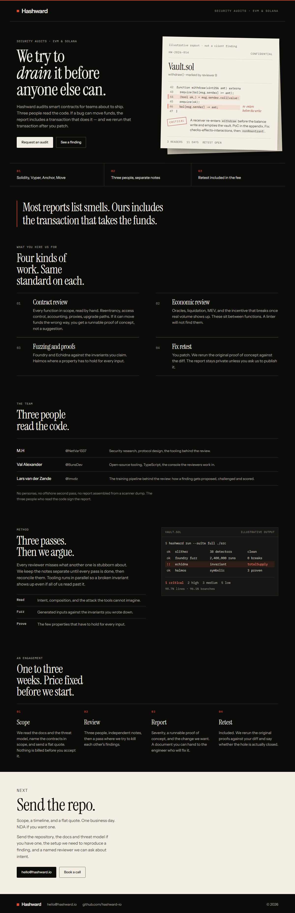

  

  <a href="https://hashward.io/#contact">Request an audit</a> ·
  <a href="mailto:hello@hashward.io">hello@hashward.io</a> ·
  <a href="https://cal.com/hashward">Book a call</a> ·
  <a href="https://github.com/hashward-io">GitHub</a>

